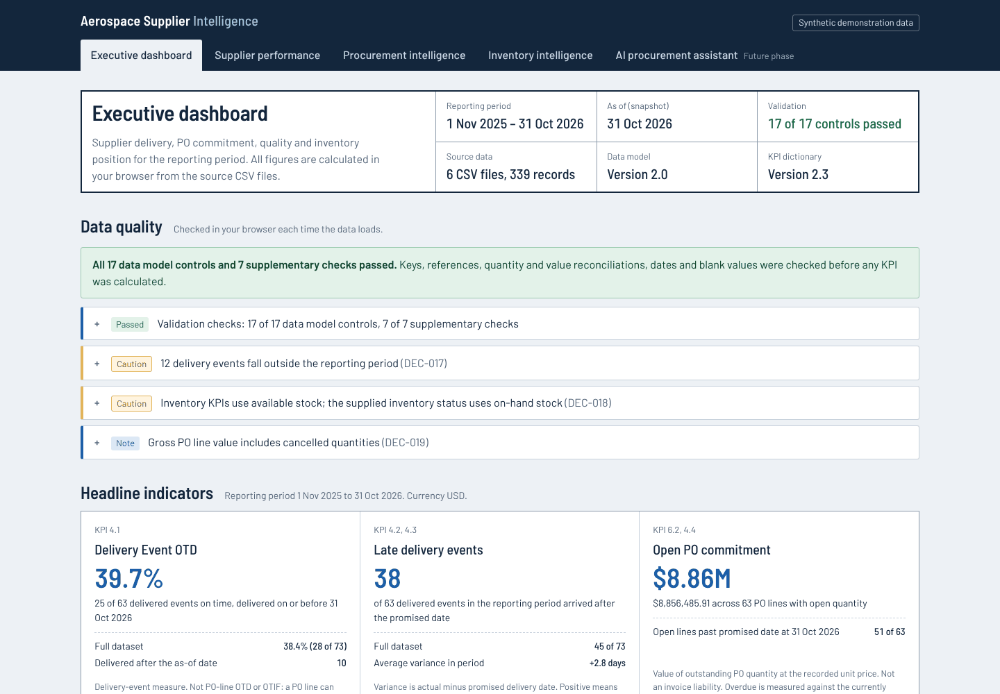

# Aerospace Supplier Intelligence Platform

**A browser-based procurement and supplier intelligence dashboard for an aerospace supply base: delivery performance, PO commitment and overdue exposure, inspection quality and inventory position, calculated live from validated data with every figure traceable to a documented KPI definition.**

**Live dashboard:** https://shahabaze.github.io/aerospace-supplier-intelligence/

> **All data is synthetic.** Suppliers, materials, purchase orders and results are invented for demonstration. They do not describe any real company, supplier or programme.



---

## What this demonstrates

| Area | What you will see |
|---|---|
| **Supplier performance** | Delivery-event on-time delivery on two clearly labelled bases, late events, delivery variance, inspection rejection rate, nonconformances, corrective actions, and supplier criticality, qualification and certification |
| **Procurement intelligence** | A PO value bridge that reconciles to the cent, overdue ageing, supplier concentration (Pareto), commitment by category and criticality, and an expediting register sorted by days past promise |
| **Inventory intelligence** | On-hand and available value, materials below reorder point and safety stock on the stricter available-stock basis, days of supply and excess value |
| **Data governance** | 17 data-model controls run in the browser before any KPI is shown, sample-size labels, "not supported" registers instead of estimated figures, and a decision log behind every rule |

### Procurement judgement built into the numbers

- **Delivery-event OTD is never presented as OTIF**, and PO-line value is never presented as invoiced spend. The data cannot support either claim, so the dashboard says so.
- **Cancelled value is separated from active commitment.** Gross $12.55M − cancelled $1.07M = net active $11.48M = received $2.62M + open $8.86M.
- **Overdue exposure is shown in value, not just line counts.** 51 of 63 open lines are past their recorded promise, $6.90M or 77.9% of open commitment. Critical suppliers carry 61.1% of it.
- **Thin evidence is flagged.** Critical suppliers hold 52.6% of active PO value but have only 4 delivered events in the period. Rates from fewer than 3 records carry a "Limited sample" label.
- **Available stock, not on-hand stock, drives reorder alerts.** Where the supplied status disagrees (MAT-010, MAT-020), both bases are shown.
- **No composite supplier risk score** is invented. Risk indicators are shown individually.

## Modules

| Module | Highlights | Screenshot |
|---|---|---|
| Executive dashboard | Six headline KPIs, data-quality panel, supplier concentration, unsupported-KPI register | [View](assets/screenshots/01-executive-dashboard.png) |
| Supplier performance | Criticality segments, PO exposure vs delivery chart, sortable and filterable comparison of 25 suppliers, supplier detail with every delivery and inspection | [View](assets/screenshots/02-supplier-performance.png), [detail](assets/screenshots/03-supplier-detail.png) |
| Procurement intelligence | PO value bridge, overdue ageing, Pareto concentration, supplier commitment table, expediting register | [View](assets/screenshots/04-procurement-intelligence.png), [register](assets/screenshots/05-expediting-register.png) |
| Inventory intelligence | Six inventory KPIs, status on both stock bases, searchable material table with supplier and material criticality | [View](assets/screenshots/06-inventory-intelligence.png) |
| AI procurement assistant | Planned for a later phase, through a secure backend; not part of this release | — |

Mobile layouts: [Executive](assets/screenshots/08-mobile-executive.png), [Procurement](assets/screenshots/09-mobile-procurement.png). Data quality: [View](assets/screenshots/07-data-quality.png).

## How to use it

1. Open the **live dashboard** link above in any modern browser. Nothing needs to be installed.
2. Use the tabs at the top to move between modules.
3. In **Supplier performance**, sort any column, filter by criticality, qualification or sample size, and select a supplier to see its deliveries and inspections. Each supplier has its own address, for example `#/suppliers/SUP-013`.
4. In **Procurement intelligence**, use the expediting register filters, for example "Over 180 days" plus "Nothing received yet", to find the lines that need action first.
5. In **Inventory intelligence**, filter by stock position or criticality, or search for a material.
6. Hover over rounded values for exact figures. Expand the data-quality notices on the Executive dashboard to see the records behind each warning.

A five-minute walkthrough for reviewers is in the [Portfolio demonstration guide](docs/portfolio-guide.md).

## Architecture

```text
Browser (static site on GitHub Pages: no server, no build step, no Python)
  data/*.csv ──► data-loader.js ──► validation.js ──► kpis.js ──► views/*.js
  six source    typed, blanks     17 Data Model      one function    Executive, Supplier,
  files         stay blank        controls + notices per KPI ID      Procurement, Inventory
```

- **Plain HTML, CSS and JavaScript.** Papa Parse and Chart.js are stored as pinned local copies, and fonts are self-hosted. No CDN, no tracking, no API keys.
- **Calculations are separate from display.** Each displayed figure is tagged with the KPI-engine result it came from, and the tests check the page against the engine.
- **Grain-safe.** PO values are aggregated from PO lines before any join, so delivery and inspection rows cannot double-count value.
- **Governing documents:** [Data Model v2.0](docs/data-model.md), [KPI Dictionary v2.3](docs/kpi-dictionary.md), [Architecture](docs/architecture.md) and [Decision Log](docs/decision-log.md) (DEC-001 to DEC-032).

## Data

Six synthetic CSV files in [`data/`](data/). Reporting period 1 Nov 2025 to 31 Oct 2026; snapshot 31 Oct 2026; USD.

| File | Records | Grain |
|---|---:|---|
| `suppliers.csv` | 25 | Supplier |
| `materials.csv` | 25 | Material |
| `purchase_orders.csv` | 100 | PO line |
| `delivery_transactions.csv` | 91 | Delivery event |
| `inventory_snapshot.csv` | 25 | Material at snapshot |
| `supplier_quality.csv` | 73 | Inspection event |

Known, documented data conditions are shown on screen rather than corrected silently. For example, 12 delivery events fall after the snapshot date, so delivery OTD is shown on a snapshot-period basis (39.7%) and a full-dataset basis (38.4%).

## Quality assurance

**274 automated browser tests**, all passing in Chrome at release. Each suite is an ordinary web page that shows pass or fail:

| Suite | Tests | Covers |
|---|---:|---|
| [`tests/data-layer-tests.html`](tests/data-layer-tests.html) | 54 | Loading, typing, the 17 controls, each control's ability to detect an injected fault |
| [`tests/kpi-tests.html`](tests/kpi-tests.html) | 88 | Every KPI against values calculated independently of the dashboard code, boundaries and governance rules |
| [`tests/dashboard-tests.html`](tests/dashboard-tests.html) | 38 | Executive dashboard, navigation, failure handling |
| [`tests/supplier-tests.html`](tests/supplier-tests.html) | 44 | Supplier comparison, sorting, filtering, detail, sample-size rule |
| [`tests/procurement-tests.html`](tests/procurement-tests.html) | 33 | Bridge, ageing, concentration, commitment table, expediting register |
| [`tests/inventory-tests.html`](tests/inventory-tests.html) | 17 | Inventory KPIs, stock bases, material table |

Each stage also included a mutation check: bugs were planted deliberately to confirm the tests catch them. Stage reports with screenshots are in [`tests/reports/`](tests/reports/).

All 274 tests also pass when run from the live site. Anyone can open the test pages above in a browser and run them.

**Testing limits:** automated tests ran in Chrome. Firefox, Safari and physical devices were not part of the automated runs. Live-site checks are recorded in [`tests/reports/stage-08-deployment.md`](tests/reports/stage-08-deployment.md).

## Not supported by the data (by design)

OTIF and complete PO-line OTD; invoiced spend; purchase price variance and savings; composite, financial or continuity supplier risk; inventory trends. Each appears in an on-screen "not supported" list with its reason, instead of an estimated figure.

## Roadmap

- AI procurement assistant answering questions from validated KPI results, through a secure backend (deferred).
- CSV export of the expediting register (deferred, DEC-031).

## Project and governance

| Role | Responsibility |
|---|---|
| Project Owner | Scope, decisions and approval of every stage |
| ChatGPT | Architecture and independent quality review |
| Claude | Implementation and testing |

Every rule that affects a number, such as the OTD bases, the inventory basis, the PO bridge, concentration, the sample-size threshold and the ageing buckets, is recorded with its approval in the [Decision Log](docs/decision-log.md).

---

**Classification:** Independent portfolio project, synthetic data. **Version:** 1.0 (first public release).
